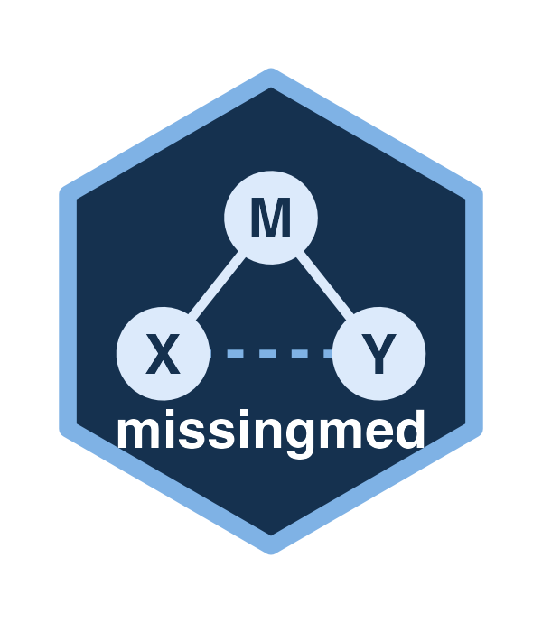

# missingmed <a href="https://data-wise.github.io/missingmed/"></a>

<!-- badges: start -->
[](https://github.com/Data-Wise/missingmed/actions/workflows/check.yml)
[](https://data-wise.r-universe.dev/missingmed)
[](https://lifecycle.r-lib.org/articles/stages.html#experimental)
[](https://www.gnu.org/licenses/gpl-3.0.html)
<!-- badges: end -->

## Overview

**missingmed** runs regression (GLM)-based mediation analysis across incomplete data and
pools with Rubin's rules. It is the *missing-data middle* of the
[mediationverse](https://github.com/Data-Wise/mediationverse): a thin
orchestration layer that **fits** each analysis with
[medfit](https://data-wise.github.io/medfit/) and delegates **inference** to
[RMediation](https://data-wise.github.io/rmediation/).

Two estimators share one S7 pipeline:

* **Multiple imputation** (`method = "mi"`) — pools per-imputation fits with
  Rubin's rules.
* **Inverse-probability weighting** (`method = "ipw"`) — reweights complete cases
  (stabilized weights, trimming, HC sandwich SEs).
* **Structural equation models** (`engine = "lavaan"`) — give lavaan syntax in
  `model`, including a latent mediator; works with both estimators. `run()` uses
  lavaan. For multiply imputed data, MBCO requires ML and refits with medfit
  0.14.0 or later. With medfit 0.19.0 or later, a supported covariance
  failure can leave enough evidence to keep a null likelihood. The warning
  identifies the dataset and the affected null (`a = 0` or `b = 0`).
* **Sensitivity to missing not at random** (`sensitivity_mnar()`) — repeats the
  analysis with the imputed values shifted, giving a sensitivity curve.

New to the package? Start with
[*Choosing an analysis*](https://data-wise.github.io/missingmed/articles/choosing-an-analysis.html).

For the indirect effect it provides both a **Monte-Carlo confidence interval**
and a **D4-stacked MBCO** likelihood-ratio test (which, unlike pooling, respects
the union-null geometry of `H0: ab = 0`).

## Installation

Install the [current release from Data-Wise R-universe](https://data-wise.r-universe.dev/missingmed)
with the tested dependency versions below. See the
[changelog](https://data-wise.github.io/missingmed/news/index.html) for release details.

```r
# install.packages("pak")
options(repos = c(
  datawise = "https://data-wise.r-universe.dev",
  CRAN = "https://cloud.r-project.org"
))
pak::pak(c(
  "missingmed",
  "Data-Wise/medfit@v0.20.0",
  "S7@1.0.0",
  "RMediation@1.11.2"
))
```

For the GitHub development branch, replace `"missingmed"` with
`"Data-Wise/missingmed@dev"`. On R 4.1, replace `"S7@1.0.0"` with
`"S7@0.2.2"`.

## The pipeline

```
set_md_mediation()  ->  run()          ->  pool()             ->  infer()
   MDMediationData       MDMediationFit     MDMediationResult      CI / MBCO
```

```r
library(missingmed)

# `imp` is a mice::mids object; X -> M -> Y with confounder C
md  <- set_md_mediation(imp, Y ~ X + M + C, M ~ X + C,
                        treatment = "X", mediator = "M")  # method = "mi" (default)
res <- pool(run(md))

infer(res, type = "mc")    # Monte-Carlo CI for the indirect effect
infer(run(md), type = "mbco", ariv = "fixed")  # D4-stacked MBCO test of H0: ab = 0
```

Inverse-probability weighting takes a raw `data.frame`:

```r
md_ipw <- set_md_mediation(df, Y ~ X + M + C, M ~ X + C,
                           treatment = "X", mediator = "M", method = "ipw")
infer(pool(run(md_ipw)), type = "mc")
```

See `vignette("missingmed")` to get started, `vignette("mbco-mi")` for why MBCO
needs the per-imputation fits, and `vignette("technical")` for the full design,
contracts, and methodology.

## Ecosystem

`missingmed` → {`medfit` (fitting), `RMediation` (inference)}; simulation via
`medsim`. All are part of the [mediationverse](https://github.com/Data-Wise/mediationverse).

## Citation

Cite the version you used:

```r
citation("missingmed")
```

## License

GPL (>= 3) · Davood Tofighi (dtofighi@gmail.com) · ORCID 0000-0001-8523-7776
